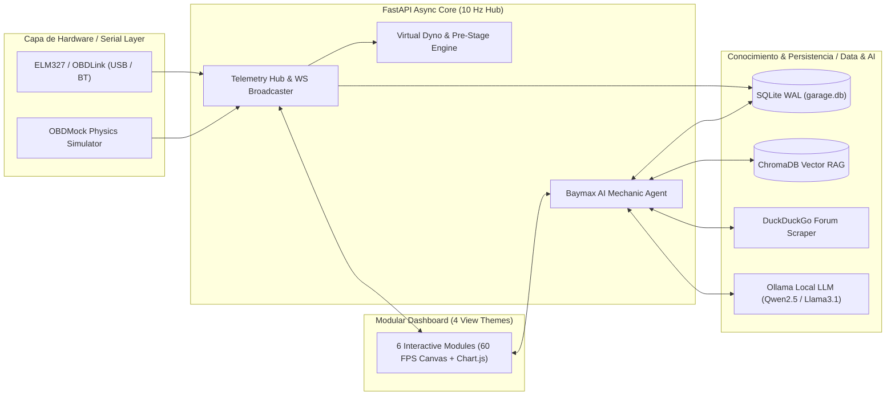

<div align="center">

# ⚡ BAYMAX OBD
### Automotive Telemetry, Physics Virtual Dyno & Local AI Diagnostic Suite
### Suite de Telemetría Automotriz, Dyno Virtual Físico y Diagnóstico Mecánico con IA Local

[](LICENSE)
[](https://www.python.org/)
[](https://fastapi.tiangolo.com/)
[](https://ollama.com/)
[](https://www.sqlite.org/)
[](#)

**Created & Engineered by [Jose Luis Alejandro Estrada Hernández](https://github.com/chewui007)**

[🇬🇧 English Documentation](#-english-documentation) • [🇪🇸 Documentación en Español](#-documentación-en-español) • [🚀 Quick Start](#-quick-start--inicio-rápido)

</div>

---

## 🇬🇧 English Documentation

### Overview
**BAYMAX OBD** is a zero-cost, cross-platform automotive engineering and diagnostic platform that unifies **10 Hz real-time OBD-II telemetry**, **Mode 02 Freeze-Frame forensics**, a **physics-based Virtual Dyno**, a **Pre-Stage ECU Tuning Validator**, and a **Local AI Mechanic Agent** powered by **Ollama + ChromaDB RAG + Live Technical Forum Scraping**.

Unlike consumer OBD dongles that only display generic trouble code definitions, **BAYMAX OBD** correlates live fuel trims (`STFT`/`LTFT`), manifold absolute pressure (`MAP`), mass airflow (`MAF`), ignition timing advance, and coolant temperatures against historical verified repairs (`garage.db`) and factory service manuals to pinpoint root mechanical causes with zero cloud API fees.

### Key Capabilities
1. **Modular 6-Workspace Engineering Dashboard (100% Responsive Desktop, Tablet & Mobile)** with **6 Adaptive View Modes**:
   - **Dark (`Oscuro`)**: Balanced graphite studio engineering palette.
   - **Light (`Blanco`)**: High-contrast daylight workshop mode for outdoor hood-open inspections.
   - **Night (`Noche`)**: Deep red/amber night-driving mode to preserve driver scotopic vision.
   - **Track (`Pista`)**: Pure OLED black with high-visibility lime motorsport contrast.
   - **F1 Neon (`F1 Neón`)**: High-intensity cyan & magenta telemetry aesthetic.
   - **Windshield HUD (`HUD Parabrisas`)**: Vertically mirrors (`scaleY(-1)`) the Live Cockpit with luminescent gauges to project telemetry directly onto the windshield at night.
   - **Responsive Mobile & Tablet Navigation**: Includes a slide-out drawer and a thumb-friendly bottom navigation dock (`.mobile-bottom-nav`) plus touch-enabled oscilloscope scrubbing.
2. **6 Dedicated Interactive Modules**:
   - **Module 1 — Live Cockpit (`Cabina en Vivo`)**: Radial SVG gauges (RPM & Speed), critical alert cards (pulsing thermal warning $>102\,^\circ\text{C}$), and a 12-sensor matrix with live `MIN` / `MAX` peak hold.
   - **Module 2 — Multi-Channel 60 FPS Oscilloscope (`Osciloscopio`)**: Dual-view analyzer (`Fuel Trims STFT vs. LTFT`, `Air/Load RPM vs. MAP/MAF`, `Thermal/Spark`) with waveform freeze and CSV data logging.
   - **Module 3 — DTC & Mode 02 Freeze-Frame Vault (`Códigos DTC`)**: Reads active/pending codes alongside the exact sensor snapshot captured by the ECU at the millisecond of failure.
   - **Module 4 — Baymax AI Mechanic & Evidence Sidebar (`Agente Mecánico`)**: Automatic context injection (active vehicle, live sensors, Freeze Frame, and historical fixes) + DuckDuckGo technical forum scraping + local PDF manual RAG. Includes a deterministic engineering diagnostic fallback when offline.
   - **Module 5 — Virtual Dyno & Pre-Stage Validator (`Dyno & Tuning`)**: Calculates Wheel Horsepower ($\text{WHP}$) and Torque ($\text{lb-ft}$) using vehicle mass, drivetrain rotational inertia, aerodynamic drag ($C_d \cdot A$), and rolling resistance, plus a 7-point automated `GO / CAUTION / NO-GO` health audit prior to ECU remapping.
   - **Module 6 — My Garage & Fleet History (`Mi Garaje`)**: Manage multiple vehicles, inspect past diagnostic sessions, and build a self-learning database of verified repairs.

---

## 🇪🇸 Documentación en Español

### Descripción General
**BAYMAX OBD** es una suite de ingeniería automotriz, telemetría en tiempo real y diagnóstico inteligente multiplataforma (**macOS, Windows y Linux**) desarrollada con **cero costos de API**. Combina lectura serial asíncrona **OBD-II a 10 Hz**, captura forense de **Freeze Frame (Modo 02)**, un **Dinamómetro Virtual basado en física real**, un **Validador Pre-Stage para reprogramación de ECU** y un **Agente Mecánico de IA Local** impulsado por **Ollama + ChromaDB (RAG) + Búsqueda Web en Foros Técnicos**.

A diferencia de los escáneres convencionales que solo traducen el código de falla de forma aislada, **BAYMAX OBD** cruza automáticamente los ajustes de combustible (`STFT`/`LTFT`), presión absoluta del múltiple (`MAP`), flujo de masa de aire (`MAF`), avance de encendido y temperatura con la foto exacta del momento del fallo, buscando soluciones reales en internet y aprendiendo de cada reparación verificada en tu propio taller (`garage.db`).

### Arquitectura del Sistema / System Architecture



---

## 🗂️ Estructura del Proyecto / Project Structure

```text
obd-baymax/
├── backend/
│   ├── main.py                 # FastAPI Server + WebSockets (10 Hz) + REST/SSE API
│   ├── config.py               # Environment & telemetry rate configuration
│   ├── database.py             # SQLite WAL engine, schema initialization & fleet seed
│   ├── models.py               # Relational schema (Vehicles, Sessions, DTCs, Logs, Telemetry, Runs)
│   ├── hub.py                  # Asynchronous 10 Hz telemetry coordinator & recorder
│   ├── hardware/
│   │   ├── port_scanner.py     # Cross-platform serial port detector (COMx & /dev/cu.*)
│   │   ├── obd_reader.py       # Real ELM327 / python-OBD Mode 01, 02, 03, 04, 07, 09 driver
│   │   ├── obd_mock.py         # Physics-based engine & drivetrain simulator
│   │   └── dtc_codes.py        # Standardized SAE J2012 DTC dictionary
│   ├── analysis/
│   │   ├── virtual_dyno.py     # Physics WHP & Torque (lb-ft) curve calculator
│   │   └── prestage_check.py   # 7-point ECU tuning readiness validator (GO / NO-GO)
│   └── agent/
│       ├── mechanic_agent.py   # Ollama LLM orchestrator + deterministic telemetry fallback
│       ├── web_researcher.py   # Free DuckDuckGo + BeautifulSoup technical forum scraper
│       └── rag_manuals.py      # Local ChromaDB vector store for PDF service manuals
├── frontend/
│   ├── index.html              # 6-Module Interactive Engineering Shell
│   ├── css/
│   │   └── style.css           # Multi-theme design system (Dark, Light, Night, Track)
│   └── js/
│       ├── telemetry_ws.js     # 10 Hz WebSocket client, 60 FPS oscilloscope & fleet UI
│       ├── dyno_prestage.js    # Virtual Dyno & Pre-Stage interactive controllers
│       └── agent_chat.js       # SSE streaming diagnostic console & verified fix logger
├── data/
│   ├── manuals/                # Drop factory workshop PDFs here for automatic RAG indexing
│   └── garage.db               # Auto-generated SQLite relational database
├── run.sh                      # One-command launcher script
├── requirements.txt            # Python dependencies
└── LICENSE                     # MIT License
```

---

## 🗄️ Esquema Relacional / Database Schema (`garage.db`)

El archivo `garage.db` implementa **5 tablas principales + registro de corridas de desempeño**:
1. **`vehicles`**: Flota registrada (`VIN`, alias, marca, modelo, año, código de motor, protocolo OBD y parámetros físicos para el Dyno).
2. **`diagnostic_sessions`**: Historial de cada conexión al puerto serial o simulador.
3. **`dtc_records`**: Códigos detectados (`ACTIVE`, `PENDING`, `CLEARED`) con su **`freeze_frame_json`** obligatorio (RPM, temperatura, carga y Fuel Trims al instante de la falla).
4. **`diagnostics_log`**: Base de conocimiento de ciclo cerrado (`symptoms_described`, `ai_hypothesis`, `web_sources_json`, `actual_fix_applied` y `verified_working`).
5. **`telemetry_snapshots`** & **`performance_runs`**: Muestreo histórico de sensores y corridas de Virtual Dyno / Pre-Stage.

---

## 🚀 Quick Start / Inicio Rápido

### 1. Clonar y Ejecutar / Clone & Run
```bash
git clone https://github.com/chewui007/obd-baymax.git
cd obd-baymax
chmod +x run.sh
./run.sh
```
Abre en tu navegador / Open in your browser: **`http://localhost:8000`**

### 2. Ejecución Manual (macOS / Linux / Windows)
```bash
python3 -m venv .venv
source .venv/bin/activate        # En Windows: .venv\Scripts\activate
pip install -r requirements.txt
uvicorn backend.main:app --host 0.0.0.0 --port 8000 --reload
```

### 3. (Opcional) Activar IA Local con Ollama / Enable Local LLM
```bash
ollama serve
ollama pull qwen2.5:7b
```
*(Si Ollama no está instalado o no hay modelo descargado, **BAYMAX OBD** activa automáticamente su motor determinista de correlación de telemetría para que nunca pierdas capacidad de diagnóstico).*

---

## 👨‍💻 Autor / Author

* **Jose Luis Alejandro Estrada Hernández** — *Creator, Lead Architect & Automotive Systems Engineer*  
  GitHub: [@chewui007](https://github.com/chewui007)

---

## 📄 Licencia / License

Este proyecto está licenciado bajo la **Licencia MIT** — consulta el archivo [LICENSE](LICENSE) para más detalles.  
Copyright © 2026 **Jose Luis Alejandro Estrada Hernández**.
